 

### Lo que hago

Vengo de agencias multimarca, donde armé CRM en HubSpot y dashboards en Power BI. Hoy diseño y mido campañas de ciclo de vida para pasajeros y conductores en **Cabify Perú**.

### En este GitHub

| | Proyecto | Qué es |
|:-:|---|---|
| 鯉 | [**maskai-ia.github.io**](https://github.com/Maskai-ia/maskai-ia.github.io) | Mi web: un CV de una sola pantalla con un estanque koi interactivo. Dale de comer a los peces. |
| ✦ | [**maskai**](https://github.com/Maskai-ia/maskai) | Reportes de IA aplicada al CRM y al marketing, explicados para no técnicos: MCP, tutores socráticos con IA y más. |

<b>In English</b>

 

I'm a **CRM Analyst at Cabify Peru**, based in Lima. I design and measure multichannel lifecycle campaigns in Braze for riders and drivers, test every campaign against a control group, and build AI agents (Claude + MCP) that help me draft, review and monitor campaigns, always with a human check before anything ships.

鯉 · la carpa que nada contra la corriente se vuelve dragón

